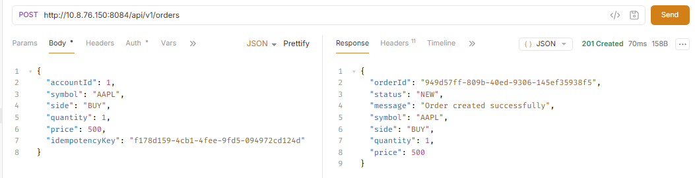
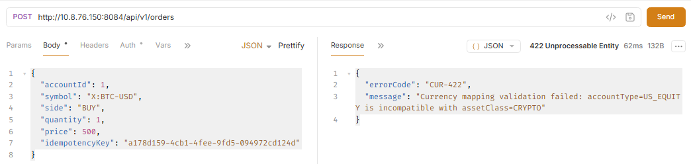
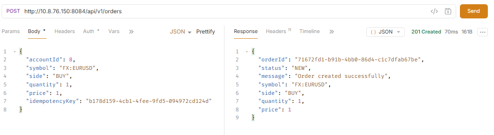
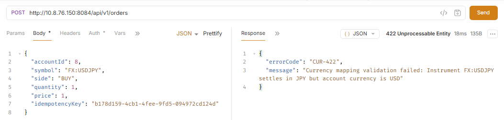
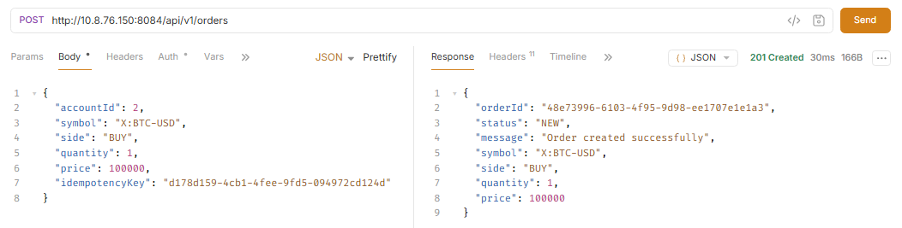
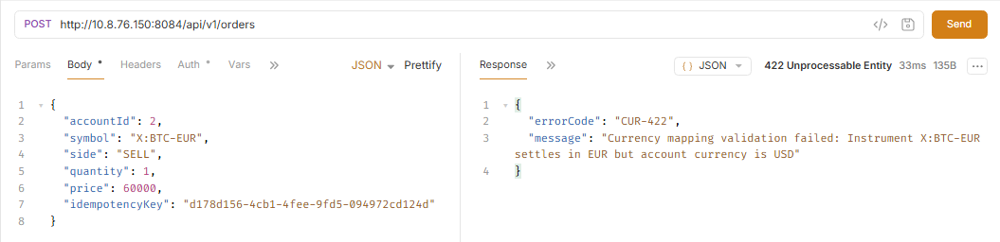

# Account Type and Asset Class Validation

This module validates whether an account is allowed to trade a specific asset class.  
Invalid combinations are rejected during order validation before the order enters the trading workflow.

The validation ensures:
- Account types only trade supported asset classes.
- Invalid trading requests return meaningful validation errors.

---

# Supported Account Type Mapping

| Account Type | Allowed Asset Class |
|--------------|---------------------|
| `US_EQUITY` | `US_EQUITY` |
| `INDIAN_EQUITY` | `INDIAN_EQUITY` |
| `FOREX` | `FX` |
| `CRYPTO` | `CRYPTO` |

---

# 1. Asset Class Mismatch Validation

## Valid Equity Order

### Request

```json
POST /api/v1/orders

{
  "accountId": 1,
  "symbol": "AAPL",
  "side": "BUY",
  "quantity": 1,
  "price": 500,
  "idempotencyKey": "f178d159-4cb1-4fee-9fd5-094972cd124d"
}
```

### Account

```text
account_type = US_EQUITY
```

### Instrument

```text
symbol = AAPL
asset_class = EQUITY
```

### Validation

```text
US_EQUITY → EQUITY
```

### Result

```text
Order Accepted
Status: NEW
```



---

## Invalid Asset Class Order

### Scenario

An equity account attempts to trade a cryptocurrency instrument.

### Request

```text
POST /api/v1/orders

{
  "accountId": 1,
  "symbol": "X:BTC-USD",
  "side": "BUY",
  "quantity": 1,
  "price": 500,
  "idempotencyKey": "a178d159-4cb1-4fee-9fd5-094972cd124d"
}
```

### Account

```text
account_type = US_EQUITY
```

### Instrument

```text
symbol = X:BTC-USD
asset_class = CRYPTO
```

### Validation

```text
US_EQUITY != CRYPTO
```

### Response

```text
{
  "errorCode": "CUR-422",
  "message": "Currency mapping validation failed: accountType=US_EQUITY is incompatible with assetClass=CRYPTO"
}
```



---

# 2. Forex Validation

Forex accounts are only allowed to trade FX instruments.

Supported mapping:

```text
Account Type : FOREX
Asset Class  : FX
```

---

## Valid Forex Order

### Request

```text
POST /api/v1/orders

{
  "accountId": 8,
  "symbol": "FX:EURUSD",
  "side": "BUY",
  "quantity": 1,
  "price": 1,
  "idempotencyKey": "b178d159-4cb1-4fee-9fd5-094972cd124d"
}
```

### Account

```text
account_type = FOREX
```

### Instrument

```text
symbol = FX:EURUSD
asset_class = FX
```

### Validation

```text
FOREX → FX
```

### Result

```text
{
  "orderId": "71672fd1-b91b-4bb0-86d4-c1c7dfab67be",
  "status": "NEW",
  "message": "Order created successfully",
  "symbol": "FX:EURUSD",
  "side": "BUY",
  "quantity": 1,
  "price": 1
}
```


---

## Invalid Forex Order

### Scenario

A Forex account attempts to trade an instrument with a different base currency.

### Request

```text
POST /api/v1/orders

{
  "accountId": 8,
  "symbol": "FX:USDJPY",
  "side": "BUY",
  "quantity": 1,
  "price": 1,
  "idempotencyKey": "b178d159-4cb1-4fee-9fd5-094972cd124d"
}
```

### Account

```text
account_type = FOREX
```

### Instrument

```text
symbol = FX:USDJPY
asset_class = FOREX
```

### Validation

```text
Instrument FX:USDJPY settles in JPY but account currency is USD
```

### Response

```text
{
  "errorCode": "CUR-422",
  "message": "Currency mapping validation failed: Instrument FX:USDJPY settles in JPY but account currency is USD"
}
```



---

# 3. Cryptocurrency Validation

Crypto accounts are only allowed to trade cryptocurrency instruments.

Supported mapping:

```text
Account Type : CRYPTO
Asset Class  : CRYPTO
```

---

## Valid Bitcoin Order

### Request

```text
POST /api/orders

{
  "accountId": 2,
  "symbol": "X:BTC-USD",
  "side": "BUY",
  "quantity": 1,
  "price": 100000,
  "idempotencyKey": "d178d159-4cb1-4fee-9fd5-094972cd124d"
}
```

### Account

```text
account_type = CRYPTO
```

### Instrument

```text
symbol = X:BTC-USD
asset_class = CRYPTO
```

### Validation

```text
CRYPTO → CRYPTO
```

### Result

```text
{
  "orderId": "48e73996-6103-4f95-9d98-ee1707e1e1a3",
  "status": "NEW",
  "message": "Order created successfully",
  "symbol": "X:BTC-USD",
  "side": "BUY",
  "quantity": 1,
  "price": 100000
}
```



---

## Invalid Bitcoin Order

### Scenario

A crypto account with invalid base currency attempts to trade Bitcoin.

### Request

```text
POST /api/orders

{
  "accountId": 2,
  "symbol": "X:BTC-EUR",
  "side": "SELL",
  "quantity": 1,
  "price": 60000,
  "idempotencyKey": "d178d156-4cb1-4fee-9fd5-094972cd124d"
}
```

### Account

```text
account_type = CRYPTO
```

### Instrument

```text
symbol = X:BTC-EUR
asset_class = CRYPTO
```

### Validation

```text
Instrument X:BTC-EUR settles in EUR but account currency is USD
```

### Response

```text
{
  "errorCode": "CUR-422",
  "message": "Currency mapping validation failed: Instrument X:BTC-EUR settles in EUR but account currency is USD"
}
```


