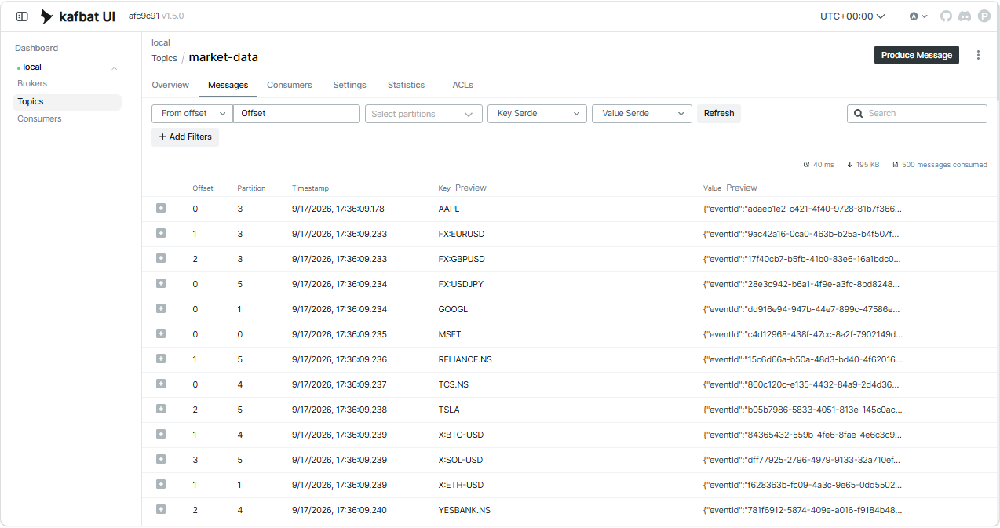

# Market Data Poller Quota Decision

Date: 2026-09-16
Service: trade-executor

## Decision

The market-data poller runs inside the existing executor process and calls Fauxnance batch quotes with up to 25 symbols per request. The poller publishes one Kafka message per symbol to the market-data topic, keyed by symbol.

The polling interval is read from POLL_INTERVAL_SECONDS and enforced in code:

- hard floor: 45 seconds
- quota rule: requests per day must be <= 2000

For symbol set size N:

- requests per poll = ceil(N / 25)
- polls per day = ceil(86400 / intervalSeconds)
- requests per day = requests per poll * polls per day
- required interval = max(45, ceil(86400 * requestsPerPoll / 2000))

If configured interval is below required interval, the poll cycle is skipped and an error is logged.

## Arithmetic Examples

Example A: 8 symbols, interval 30 seconds

- requests per poll = ceil(8 / 25) = 1
- polls per day = ceil(86400 / 30) = 2880
- requests per day = 1 * 2880 = 2880 (exceeds 2000)

Example B: 8 symbols, interval 45 seconds

- requests per poll = ceil(8 / 25) = 1
- polls per day = ceil(86400 / 45) = 1920
- requests per day = 1 * 1920 = 1920 (within quota)

Example C: 50 symbols

- requests per poll = ceil(50 / 25) = 2
- required interval from quota = ceil((86400 * 2) / 2000) = 87
- enforced required interval = max(45, 87) = 87 seconds

## Screenshot 

