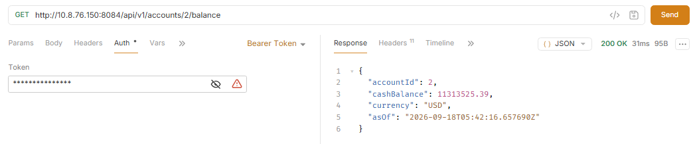
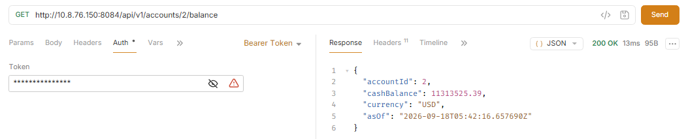
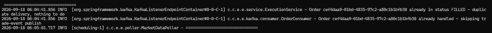

# Order DLT Kafbat Test Messages

Use these examples in Kafbat UI to send records to the `orders` topic and observe how different input cases are handled.

## Topic

```text
orders
```

## How to use in Kafbat

1. Open **Topics**.
2. Select **orders**.
3. Click **Produce Message**.
4. Paste the key and value for one case below.
5. Send the message.
6. Open **orders.DLT** to inspect the resulting record.

## Case 1 - Invalid message format

**Key**

```text
100
```

**Value**

```json
not-a-valid-json
```

## Case 2 - Order identifier provided as null

**Key**

```text
100
```

**Value**

```json
{
  "eventId": "10000000-0000-0000-0000-000000000011",
  "eventType": "ORDER_PLACED",
  "timestamp": "2026-09-17T11:20:00Z",
  "source": "manual-test",
  "version": 1,
  "payload": {
    "orderId": null,
    "accountId": 100,
    "symbol": "AAPL",
    "side": "BUY",
    "quantity": 10,
    "limitPrice": 150.00,
    "idempotencyKey": "case-2",
    "occurredAt": "2026-09-17T11:20:00Z"
  }
}
```

## Case 3 - Payload provided as null

**Key**

```text
100
```

**Value**

```json
{
  "eventId": "10000000-0000-0000-0000-000000000012",
  "eventType": "ORDER_PLACED",
  "timestamp": "2026-09-17T11:21:00Z",
  "source": "manual-test",
  "version": 1,
  "payload": null
}
```

## Case 4 - Order identifier not present in the database

**Key**

```text
100
```

**Value**

```json
{
  "eventId": "10000000-0000-0000-0000-000000000013",
  "eventType": "ORDER_PLACED",
  "timestamp": "2026-09-17T11:22:00Z",
  "source": "manual-test",
  "version": 1,
  "payload": {
    "orderId": "99999999-9999-9999-9999-999999999999",
    "accountId": 100,
    "symbol": "AAPL",
    "side": "BUY",
    "quantity": 10,
    "limitPrice": 150.00,
    "idempotencyKey": "case-4",
    "occurredAt": "2026-09-17T11:22:00Z"
  }
}
```

## Case 5 - Different event type on the orders topic

**Key**

```text
100
```

**Value**

```json
{
  "eventId": "10000000-0000-0000-0000-000000000014",
  "eventType": "ORDER_UPDATED",
  "timestamp": "2026-09-17T11:23:00Z",
  "source": "manual-test",
  "version": 1,
  "payload": {
    "orderId": "99999999-9999-9999-9999-999999999999",
    "accountId": 100,
    "symbol": "AAPL",
    "side": "BUY",
    "quantity": 10,
    "limitPrice": 150.00,
    "idempotencyKey": "case-5",
    "occurredAt": "2026-09-17T11:23:00Z"
  }
}
```

## Case 6 - Empty payload object

**Key**

```text
100
```

**Value**

```json
{
  "eventId": "10000000-0000-0000-0000-000000000015",
  "eventType": "ORDER_PLACED",
  "timestamp": "2026-09-17T11:24:00Z",
  "source": "manual-test",
  "version": 1,
  "payload": {}
}
```

# Duplicate Order Event Delivery (Idempotency Validation)

Verifies that replaying the same order event does not create a duplicate trade execution. The executor identifies the duplicate using `idempotencyKey` / `eventId` and ignores the second delivery.


## First Delivery

**Key:** `1`

**Value:**
```json
{
	"eventId": "78a76829-1f48-4760-b061-8d5ac3a880df",
	"eventType": "ORDER_PLACED",
	"eventTime": "2026-09-17T18:42:28.520023633Z",
	"source": "trade-api",
	"schemaVersion": 1,
	"payload": {
		"orderId": "cef4daa9-01bd-4835-97c2-a80c1b1bfb38",
		"accountId": 1,
		"symbol": "AAPL",
		"side": "BUY",
		"quantity": 1,
		"price": 500,
		"idempotencyKey": "d178d159-4cb1-4fee-9fd5-094972cd124d",
		"createdOn": "2026-09-17T18:42:28.506770047Z"
	}
}
```

**Expected Result:**
```
Order processed successfully.
Account balance updated.
Trade event published.
Order execution completed.
```

## Second Delivery (Same Message Replay)

Send the exact same key and value again.

**Expected Duplicate Handling:**
```
Duplicate order event detected.
No second account debit performed.
No duplicate trade event published.
Existing execution result reused/ignored.
```

**Example log:**
```
Duplicate event detected: eventId=10000000-0000-0000-0000-000000000016
Skipping order execution.
```

## Screenshots

Account balance before duplicate delivery


Account balance after duplicate delivery


Console Message

