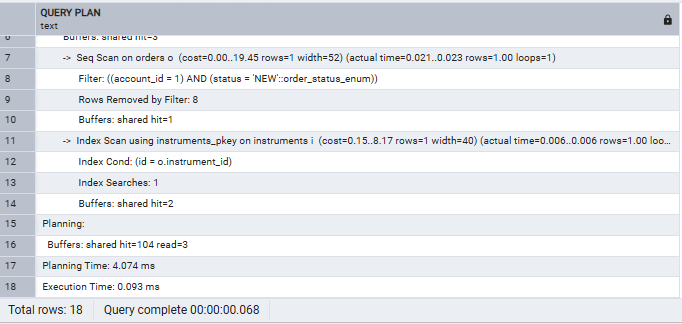
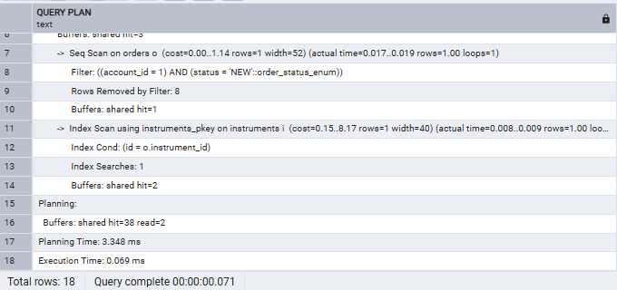
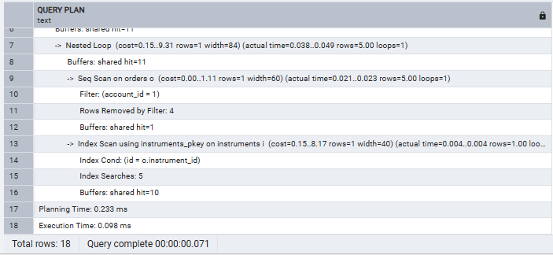
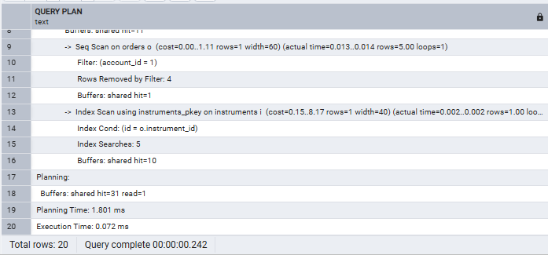
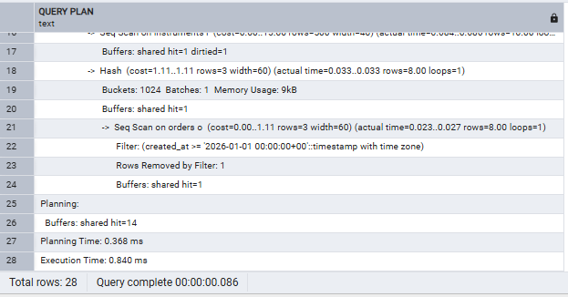
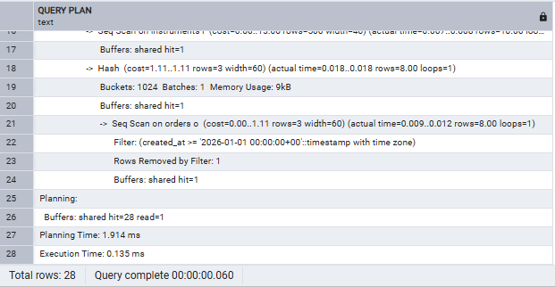

# Database Index Justification Report

## Overview

This document explains the index decisions made for the trading platform database.

Indexes were added only where they provide a clear improvement for important application queries. 

The `orders` table is expected to be the most write-heavy table, so indexes on this table were carefully justified.

---

# Index 1: idx_orders_account_status_created

### Supports Query

**Query 1: All open orders for one account, newest first**

Used by: Trading blotter/dashboard.

### Index Created

```sql
CREATE INDEX idx_orders_account_status_created
ON orders(account_id, status, created_at DESC);
```

### Before Adding Index

The database must scan the orders table to find matching records.

Execution behaviour:

- Sequential scan of `orders`
- Filter rows by `account_id`
- Filter rows by `status`
- Sort results by `created_at DESC`

This is inefficient because the database reads unnecessary rows and performs an additional sorting step.

### After Adding Index

The database can use the index to directly locate matching rows.

Execution behaviour:

- Index scan using `idx_orders_account_status_created`
- Filter by `account_id` and `status` using the index
- Retrieve rows already ordered by `created_at DESC`

The separate sorting operation is removed.

### Justification

This index directly matches the dashboard access pattern:

- find orders for a specific account,
- find orders in a specific state,
- display newest orders first.

The query is expected to run frequently, so reducing lookup and sorting cost improves user-facing performance.

### Write Cost

The cost is additional storage and index maintenance.

Every new order insert requires an update to this index. Updates affecting `account_id`, `status`, or `created_at` also require index maintenance.

The additional write cost is justified because this supports a frequently accessed trading workflow.

---

# Index 2: idx_orders_account_created

### Supports Query

**Query 2: Last 50 orders for one account in any state, newest first**

Used by: Order history screen.

### Index Created

```sql
CREATE INDEX idx_orders_account_created
ON orders(account_id, created_at DESC);
```

### Before Adding Index

The database must:

- scan orders,
- filter by account,
- sort matching rows by creation date,
- return the first 50 records.

This requires unnecessary processing when only the newest 50 rows are required.

### After Adding Index

The database can:

- locate the account's orders using the index,
- read rows directly in newest-first order,
- stop once 50 rows have been returned.

The sort operation is avoided and fewer rows need to be processed.

### Justification

This index supports a common application pattern:

- account-specific lookup,
- newest-first ordering,
- limited result set.

The index improves response time for the order history view.

### Write Cost

The index increases storage requirements and adds maintenance work for inserts and updates.

Every order creation requires an additional index update. The cost is accepted because the history query is frequently used.

---

# Index 3: idx_orders_created_at

### Supports Query

**Query 4: Every order created since a given timestamp**

Used by: Nightly analytical extract.

### Index Created

```sql
CREATE INDEX idx_orders_created_at
ON orders(created_at);
```

### Before Adding Index

The database must scan all rows in `orders` and check which rows satisfy the timestamp condition.

This creates unnecessary work when only recent orders are required.

### After Adding Index

The database can perform a range lookup using the index:

- jump directly to the required timestamp range,
- retrieve only matching orders.

This improves incremental data extraction performance.

### Justification

The analytical pipeline frequently needs recently created records rather than the entire orders table.

A B-tree index on `created_at` is appropriate for timestamp range queries.

### Write Cost

Every inserted order creates another index entry.

Updates and deletes also require index maintenance.

The additional write overhead is acceptable because the index improves a recurring analytical workload.

---

# Queries That Require No New Index

## Query 3: Current Holdings for One Account

No additional index was created.

Existing constraints already provide suitable indexes:

- `portfolios.account_id UNIQUE`
- `portfolio_holdings(portfolio_id, instrument_id) UNIQUE`

These indexes allow efficient lookup through:

```
Account
   ↓
Portfolio
   ↓
Portfolio Holdings
```

Creating another index would add write overhead without providing significant improvement.

---

## Query 5: Resolve Account Using Customer Reference

No additional index was created.

The column:

```
accounts.account_ref UNIQUE
```

already creates an index automatically.

This supports fast lookup of accounts using the customer-facing reference.

A separate index would duplicate existing functionality.

---

# Query 6: Filled Order Statement

No additional index was created.

This query requires analytical operations:

- running total of cash committed,
- ranking orders by value within each instrument,
- ordering by execution time.

The correct solution is a CTE or window function.

This query does not receive an index because the task specifies that Query 6 earns no index justification.

---

# Final Summary

| Index | Supported Query | Benefit |
|---|---|---|
| `idx_orders_account_status_created` | Query 1 | Faster account/status filtering and newest-first ordering |
| `idx_orders_account_created` | Query 2 | Faster retrieval of latest 50 account orders |
| `idx_orders_created_at` | Query 4 | Faster timestamp-based extraction |

These indexes improve important read paths while balancing the cost of additional storage and slower writes. The indexes were limited to cases where the performance improvement justifies the maintenance overhead.


RUNNING EXPLAIN ANALYZE ON QUERIES BEFORE AND AFTER INDEXING 

### Query 1 — Execution Plan Before Indexing



### Query 1 — Execution Plan After Indexing



### Query 2 — Execution Plan Before Indexing



### Query 2 — Execution Plan After Indexing



### Query 4 — Execution Plan Before Indexing



### Query 4 — Execution Plan After Indexing

