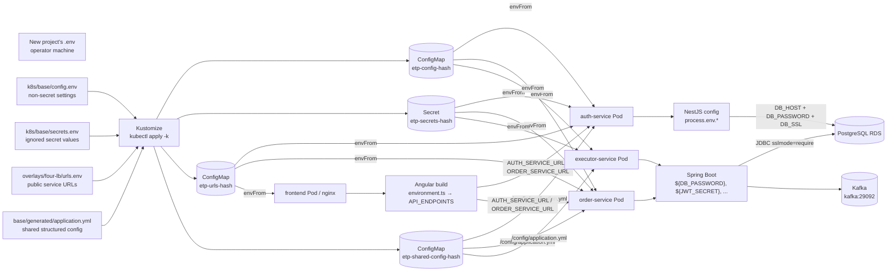

# EKS Deployment Guide

This guide documents the deployment used for this project and explains which
parts of `k8s/` are reusable for another project.

## Configuration Map

The important rule is: **values flow into pods through ConfigMaps and Secrets;
the applications read environment variables, not the files on the operator's
laptop.** Secret names are shown below, but secret values must never be placed
in this diagram or committed to Git.



### Example Mappings

| Source value | Kubernetes object | Pod connection | Code usage |
| --- | --- | --- | --- |
| `DB_PASSWORD` in `secrets.env` | Generated `etp-secrets-*` Secret | `envFrom` in auth/order/executor | NestJS `process.env.DB_PASSWORD`; Spring `${DB_PASSWORD}` |
| `JWT_SECRET` in `secrets.env` | Generated `etp-secrets-*` Secret | `envFrom` in auth/order/executor | JWT signing and verification |
| `DB_HOST`, `DB_NAME`, `DB_SCHEMA_TRADE` in `config.env` | Generated `etp-config-*` ConfigMap | `envFrom` in auth/order/executor | PostgreSQL host, database, and schema settings |
| `AUTH_SERVICE_URL` and `ORDER_SERVICE_URL` in `urls.env` | Generated `etp-urls-*` ConfigMap | `envFrom` in application pods | Frontend build endpoint generation and CORS/runtime URL config |
| `generated/application.yml` | Generated `etp-shared-config-*` ConfigMap | Mounted at `/config/application.yml` | Shared structured defaults and service configuration |
| ECR image entries in `base/kustomization.yaml` | Deployment container image | Pulled by EKS nodes | Runs the built application code |

`config.env` and `secrets.env` are read by Kustomize only when applying the
manifests. A local root `.env` is not automatically read by Kubernetes. Copy
the relevant values into the ignored Kubernetes files or use a secret manager.

## Architecture

The deployment contains:

- An EKS control plane and a managed EC2 node group.
- Kafka running as a single-node KRaft StatefulSet with an encrypted EBS gp3 volume.
- Auth, order, executor, and frontend application workloads.
- An existing PostgreSQL RDS instance. The optional in-cluster PostgreSQL is not used.
- Four Kubernetes `LoadBalancer` Services for the first test deployment.

The four-load-balancer layout is useful for initial connectivity testing. For a
real browser deployment, prefer the ingress overlay: one ALB gives the frontend
and APIs one origin and avoids cross-site refresh-cookie problems.

## Prerequisites

Install or verify these tools:

```bash
aws --version
kubectl version --client
helm version
eksctl version
docker --version
```

Install `eksctl` on Linux if it is missing:

```bash
ARCH=$(uname -m)
case "$ARCH" in
  x86_64) EKSCTL_ARCH=amd64 ;;
  aarch64) EKSCTL_ARCH=arm64 ;;
  *) echo "Unsupported architecture: $ARCH"; exit 1 ;;
esac

curl --fail --location \
  "https://github.com/eksctl-io/eksctl/releases/latest/download/eksctl_Linux_${EKSCTL_ARCH}.tar.gz" \
  | tar xz -C /tmp
sudo install -m 0755 /tmp/eksctl /usr/local/bin/eksctl
eksctl version
```

Authenticate AWS and select a region:

```bash
aws configure
aws sts get-caller-identity
export AWS_REGION=ap-south-1
aws configure set region "$AWS_REGION"
```

## Create EKS

Edit [`cluster.example.yaml`](cluster.example.yaml) for the project name,
region, node type, and node count. Choose capacity based on the workloads your
project runs; Kafka and Java services need more memory than a minimal cluster.

Create a cluster from the example:

```bash
eksctl create cluster -f k8s/cluster.example.yaml
```

If CloudFormation reports that `eksctl-<name>-cluster` already exists, do not
run the create command again. Inspect the existing operation:

```bash
aws cloudformation describe-stacks \
  --region "$AWS_REGION" \
  --stack-name eksctl-<name>-cluster \
  --query 'Stacks[0].{Status:StackStatus,Reason:StackStatusReason}' \
  --output table

aws eks describe-cluster \
  --region "$AWS_REGION" \
  --name <name> \
  --query 'cluster.status' \
  --output text
```

If the control plane is `ACTIVE` but no nodegroup exists, add workers without
recreating the cluster:

```bash
eksctl create nodegroup \
  --cluster <name> \
  --region "$AWS_REGION" \
  --name workers \
  --node-type <node-type> \
  --nodes <desired-nodes> \
  --nodes-min <minimum-nodes> \
  --nodes-max <maximum-nodes> \
  --managed \
  --node-private-networking
```

Configure `kubectl` and verify workers before applying manifests:

```bash
aws eks update-kubeconfig --region "$AWS_REGION" --name <name>
kubectl config current-context
kubectl get nodes -o wide
```

## Storage Addon

Kafka uses the `gp3` StorageClass, which requires the AWS EBS CSI driver. The
cluster must have **OpenID Connect (OIDC)** or EKS Pod Identity configured so
the driver can call EC2 APIs. OIDC is the standard identity protocol that lets
an AWS IAM role trust a Kubernetes service account. In EKS this is commonly
called **IAM Roles for Service Accounts (IRSA)**: the EBS CSI pod receives AWS
permissions through its service account instead of receiving broad permissions
through every worker node.

Preferred approach for a new cluster:

```bash
eksctl create addon \
  --cluster <name> \
  --region "$AWS_REGION" \
  --name aws-ebs-csi-driver \
  --force
```

Verify it before applying Kafka:

```bash
kubectl get pods -n kube-system | grep ebs
kubectl get storageclass gp3
```

If OIDC was not enabled and an immediate test-cluster recovery is needed, the
nodegroup role can be discovered and granted the managed EBS policy. This is
less isolated than IRSA and should not be the production design:

```bash
CLUSTER_NAME=<your-cluster-name>
NODEGROUP=$(aws eks list-nodegroups \
  --region "$AWS_REGION" \
  --cluster-name "$CLUSTER_NAME" \
  --query 'nodegroups[0]' --output text)
NODE_ROLE_ARN=$(aws eks describe-nodegroup \
  --region "$AWS_REGION" \
  --cluster-name "$CLUSTER_NAME" \
  --nodegroup-name "$NODEGROUP" \
  --query 'nodegroup.nodeRole' --output text)
NODE_ROLE_NAME="${NODE_ROLE_ARN##*/}"

aws iam attach-role-policy \
  --role-name "$NODE_ROLE_NAME" \
  --policy-arn arn:aws:iam::aws:policy/service-role/AmazonEBSCSIDriverPolicy
```

Use a dedicated addon role or EKS Pod Identity for production instead of adding
storage permissions to worker nodes.

## RDS Connectivity

The EKS nodes need network access to the RDS endpoint. VPC peering is only
needed when EKS and RDS are in different VPCs without another route between
them. For the same VPC, configure the RDS security group to allow TCP `5432`
from the EKS node security group:

```bash
CLUSTER_NAME=<your-cluster-name>
RDS_HOST=$(awk -F= '$1 == "DB_HOST" {print $2}' k8s/base/config.env)
RDS_INSTANCE_ID=$(aws rds describe-db-instances \
  --region "$AWS_REGION" \
  --query "DBInstances[?Endpoint.Address=='${RDS_HOST}'].DBInstanceIdentifier | [0]" \
  --output text)
NODEGROUP=$(aws eks list-nodegroups \
  --region "$AWS_REGION" \
  --cluster-name "$CLUSTER_NAME" \
  --query 'nodegroups[0]' --output text)
NODE_INSTANCE_ID=$(aws ec2 describe-instances \
  --region "$AWS_REGION" \
  --filters "Name=tag:eks:nodegroup-name,Values=$NODEGROUP" \
            "Name=instance-state-name,Values=running" \
  --query 'Reservations[].Instances[0].InstanceId | [0]' \
  --output text)
RDS_SECURITY_GROUP_ID=$(aws rds describe-db-instances \
  --region "$AWS_REGION" \
  --db-instance-identifier "$RDS_INSTANCE_ID" \
  --query 'DBInstances[0].VpcSecurityGroups[0].VpcSecurityGroupId' \
  --output text)
EKS_NODE_SECURITY_GROUP_ID=$(aws ec2 describe-instances \
  --region "$AWS_REGION" \
  --instance-ids "$NODE_INSTANCE_ID" \
  --query 'Reservations[0].Instances[0].SecurityGroups[0].GroupId' \
  --output text)

aws ec2 authorize-security-group-ingress \
  --group-id "$RDS_SECURITY_GROUP_ID" \
  --protocol tcp \
  --port 5432 \
  --source-group "$EKS_NODE_SECURITY_GROUP_ID" || \
  echo 'The rule may already exist; inspect the RDS security group.'
```

Only `CLUSTER_NAME` and `AWS_REGION` are project choices in that discovery
block. It assumes EKS and RDS are in the same VPC. Cross-VPC peering requires
routes and a CIDR-based security-group rule instead of `--source-group`.

Check the path from inside Kubernetes:

```bash
kubectl run rds-test --rm -it --restart=Never \
  --image=postgres:16 -- bash
```

Inside the temporary pod, `PGPASSWORD` is the password for the RDS database
user in `DB_USER`. Kubernetes does not automatically read your local `.env`
when you run an ad-hoc command, so enter it through a prompt rather than putting
it in shell history:

```bash
read -rsp 'RDS password: ' PGPASSWORD; echo
RDS_HOST=$(awk -F= '$1 == "DB_HOST" {print $2}' k8s/base/config.env)
DB_NAME=$(awk -F= '$1 == "DB_NAME" {print $2}' k8s/base/config.env)
DB_USER=$(awk -F= '$1 == "DB_USER" {print $2}' k8s/base/config.env)
PGPASSWORD="$PGPASSWORD" pg_isready \
  -h "$RDS_HOST" -p 5432 -U "$DB_USER" -d "$DB_NAME"
unset PGPASSWORD
```

For the application deployment, Kustomize reads the local ignored
`k8s/base/secrets.env` during `kubectl apply`; it does not read the root `.env`
implicitly. Copy the values explicitly from the new project's `.env` into the
secret file, or generate the Kubernetes Secret through a secrets manager.

For this deployment, Java uses encrypted PostgreSQL connections with
`sslmode=require`. Certificate verification is intentionally disabled in the
current test setup; use the RDS CA bundle and `verify-full` for production.

## ECR Images

Create one private ECR repository per application image:

```bash
for repo in etp-auth-service etp-order-service etp-executor-service etp-frontend; do
  aws ecr create-repository \
    --region "$AWS_REGION" \
    --repository-name "$repo" \
    --image-scanning-configuration scanOnPush=true \
    --encryption-configuration encryptionType=AES256 || true
done
```

Authenticate and push images:

```bash
AWS_ACCOUNT_ID=$(aws sts get-caller-identity --query Account --output text)
REGISTRY="$AWS_ACCOUNT_ID.dkr.ecr.$AWS_REGION.amazonaws.com"

aws ecr get-login-password --region "$AWS_REGION" \
  | docker login --username AWS --password-stdin "$REGISTRY"

docker build -t etp-auth-service ./services/auth_service
docker build -t etp-order-service ./services/trade-api
docker build -t etp-executor-service ./services/executor
docker build -t etp-frontend ./frontend

for image in etp-auth-service etp-order-service etp-executor-service etp-frontend; do
  docker tag "$image:latest" "$REGISTRY/$image:latest"
  docker push "$REGISTRY/$image:latest"
done
```

Those ECR commands are directly runnable after setting `AWS_REGION` and from
the application repository root. They use the current AWS account and do not
require manually copying an account ID. The image names and build directories
must still match the target project's services.

Update the `images` block in [`base/kustomization.yaml`](base/kustomization.yaml)
with the new registry and immutable image tags or digests. Do not leave another
project's AWS account ID or image tag in that file.

## Project Configuration

Copy the deployment kit into the project root and configure these files:

1. [`base/config.env`](base/config.env): non-secret settings such as RDS host,
   database name, schemas, ports, Kafka topics, service URLs, and feature flags.
2. [`base/secrets.env.example`](base/secrets.env.example): template only. Copy
   it to `base/secrets.env` locally and fill in passwords, JWT secrets, and API
   keys. The real file is ignored by Git.
3. [`base/generated/application.yml`](base/generated/application.yml): the
  structured shared configuration file mounted at `/config` and referenced by
  `SHARED_CONFIG`. `config.env` supplies flat environment variables through
  `envFrom`; this YAML supplies the file-based configuration contract and
  structured defaults expected by the service images. They are complementary,
  not two automatic copies of the same file. Replace it with the target
  project's compatible shared configuration and keep both contracts aligned.
4. `overlays/four-lb/urls.env`: public frontend/API hostnames after the
   LoadBalancers receive DNS names. Values must match how the application joins
   hostnames and ports.
5. [`base/kustomization.yaml`](base/kustomization.yaml): image repositories and
   tags, plus the resource list.

Render before applying:

```bash
kubectl kustomize k8s/overlays/four-lb >/tmp/rendered.yaml
kubectl apply --dry-run=server -k k8s/overlays/four-lb
```

Apply the first four-LB deployment:

```bash
kubectl apply -k k8s/overlays/four-lb
kubectl get pods -w
kubectl get svc
```

Use the one-ALB ingress later:

```bash
kubectl apply -k k8s/overlays/ingress
kubectl get ingress
```

## File Reference

### Cluster and Base

- `cluster.example.yaml`: `eksctl` cluster configuration, managed nodegroup,
  OIDC setting, and AWS addons.
- `base/kustomization.yaml`: base resource list, generated ConfigMaps/Secret,
  and ECR image replacement rules.
- `base/namespace.yaml`: creates the `etp` namespace. Confirm the workloads
  target this namespace before production use.
- `base/config.env`: non-secret application configuration.
- `base/secrets.env.example`: safe secret template; never commit the populated
  `secrets.env`.
- `base/generated/application.yml`: shared Spring/Node configuration mounted at
  `/config`.
- `base/storageclass.yaml`: encrypted EBS gp3 storage for StatefulSets.

### Application Workloads

- `base/auth-service.yaml`: auth Deployment and Service on port `3000`.
- `base/order-service.yaml`: Spring trade/order Deployment and Service on port
  `8081`.
- `base/executor-service.yaml`: executor worker Deployment and Service on port
  `8082`.
- `base/frontend.yaml`: nginx frontend Deployment and Service on port `80`.
- `base/kafka.yaml`: single-node Kafka KRaft Service, StatefulSet, probes, and
  persistent volume claim.
- `base/kafka-topics-job.yaml`: one-shot Kafka topic creation Job. It can be
  rerun only after deleting the completed Job.

### Overlays

- `overlays/four-lb/kustomization.yaml`: changes frontend, auth, order, and
  executor Services to `LoadBalancer`.
- `overlays/four-lb/urls.env`: public hostnames consumed by the applications.
- `overlays/ingress/kustomization.yaml`: combines the base with one ALB Ingress.
- `overlays/ingress/ingress.yaml`: routes `/auth`, `/api/v1`, health, and frontend
  traffic through one ALB. Add ACM HTTPS annotations before production use.
- `overlays/ingress/urls.env`: browser-facing URLs for the one-ALB deployment.

### Optional and Support Files

- `optional/postgres/postgres.yaml`: optional in-cluster PostgreSQL StatefulSet;
  do not include it when using RDS.
- `optional/postgres/kustomization.yaml`: resources for the optional PostgreSQL
  overlay.
- `optional/postgres/.gitignore`: ignores generated database seed artifacts.
- `.gitignore` files: keep generated secrets and local files out of Git.
- `kustomize-0.6.0-py3-none-any.whl`: offline packaging artifact; normal EKS
  deployments use the `kubectl`-bundled Kustomize instead.

## Troubleshooting

```bash
kubectl get pods -A
kubectl describe pod <pod>
kubectl logs deployment/auth-service --tail=100
kubectl logs deployment/order-service --tail=100
kubectl get pvc
kubectl get events --sort-by=.lastTimestamp
```

Common symptoms:

- `remaining connection slots are reserved`: stop duplicate local Compose
  workloads and reduce connection pools or resize the small RDS instance.
- Kafka `Pending`: install the EBS CSI driver and check `kubectl get pvc`.
- Browser calls `localhost`: rebuild the frontend with the target URLs; browser
  `localhost` means the user's machine, not the EKS cluster.
- HTTP `400` with UUID parsing: verify client-generated idempotency/request IDs
  are standard UUIDs.

## Cleanup

Delete application resources:

```bash
kubectl delete -k k8s/overlays/four-lb
```

Delete the complete EKS cluster only when its resources are no longer needed:

```bash
eksctl delete cluster --region "$AWS_REGION" --name <name>
```
